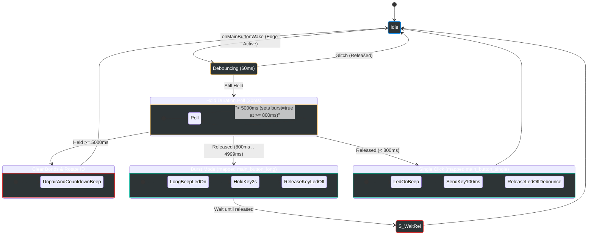
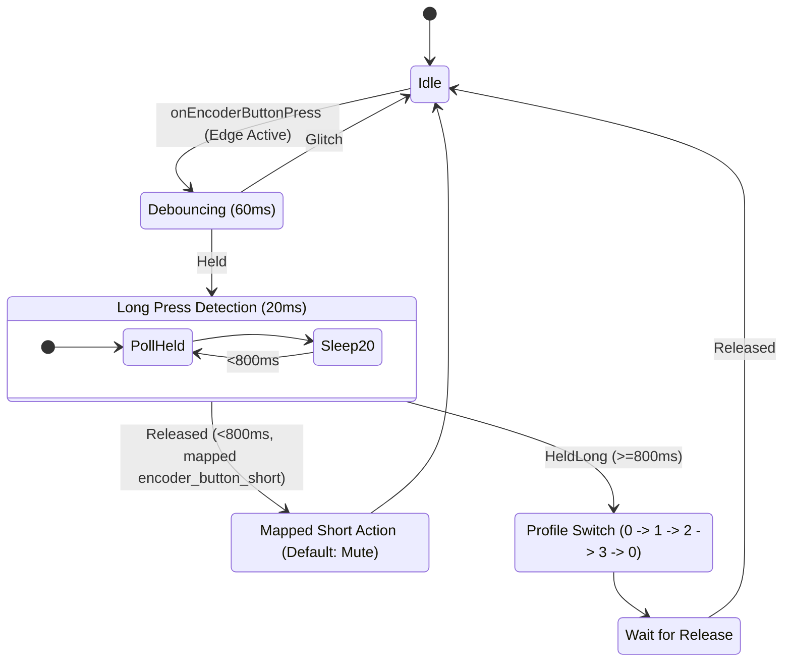

# Gesture Engine Logic

This diagram illustrates the state transitions and timing logic implemented in `GestureEngine` (`firmware/src/gesture_engine.hpp`) for the main shutter buttons, rotary encoder, and encoder push button.

## Main Button Logic

## Encoder Rotation & Button Logic

- **Rotary Encoder (`on_encoder_rotate`)**: Deferred from the `qdec_nrfx` ISR to `encoder_rot_thread`. Accumulates degrees and emits up to `kMaxStepsPerReport` (`10`) HID press/release events per batch at `kDegreesPerDetent` (`60`°) intervals using `ConfigMappings.encoder_cw` (negative) or `ConfigMappings.encoder_ccw` (positive).

## Timing & Geometry Constants
| Parameter | Value | Description |
| :--- | :--- | :--- |
| `kDebounceMs` | 60 ms | Initial noise filtering & post-click cooldown |
| `kPollMs` | 20 ms | Interval for checking button state during hold |
| `kLongPressMs` | 800 ms | Threshold for Burst Mode / Profile Switch |
| `kBurstHoldMs` | 2000 ms | Duration the mapped key stays held in Burst Mode |
| `kResetHoldMs` | 5000 ms | Threshold to clear bonds and rotate slot BT ID |
| `kDegreesPerDetent` | 60 deg | QDEC angle threshold per encoder detent |
| `kMaxStepsPerReport` | 10 | Upper bound on detents emitted in a single rotation call |
