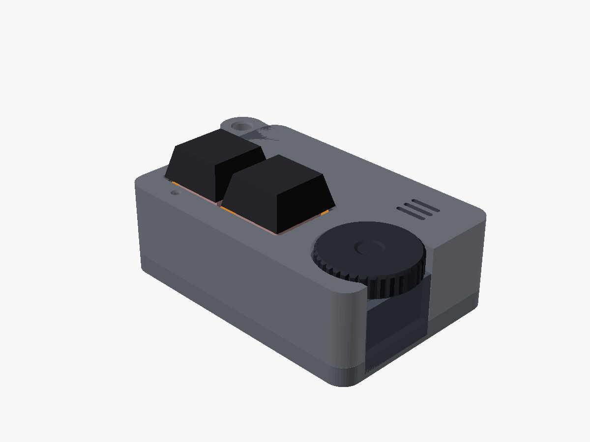
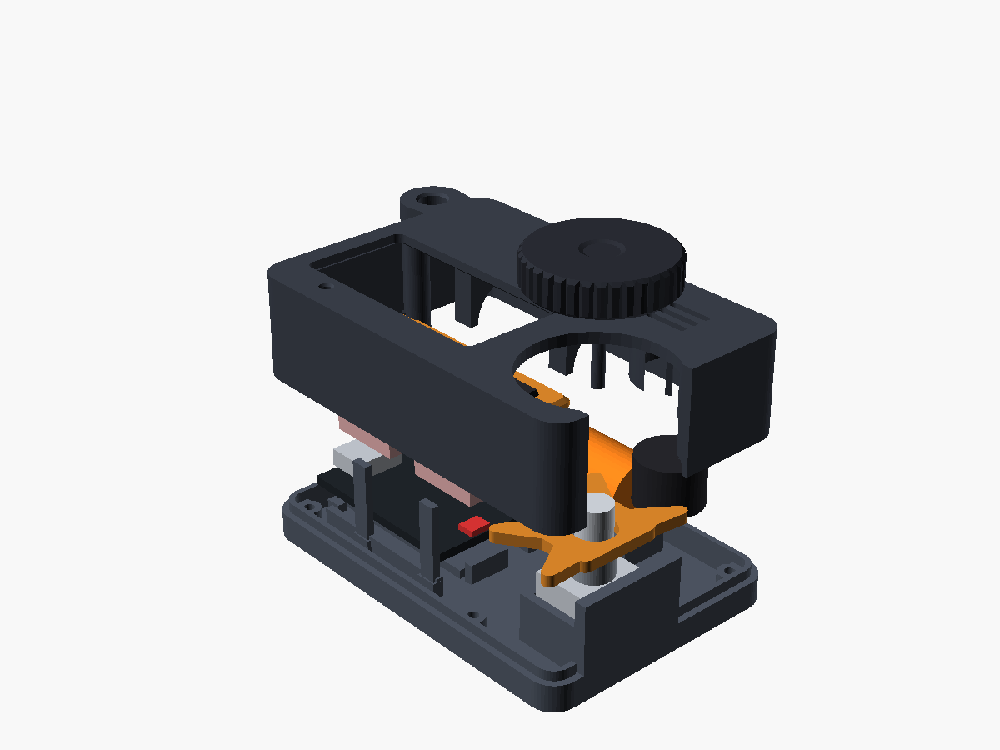
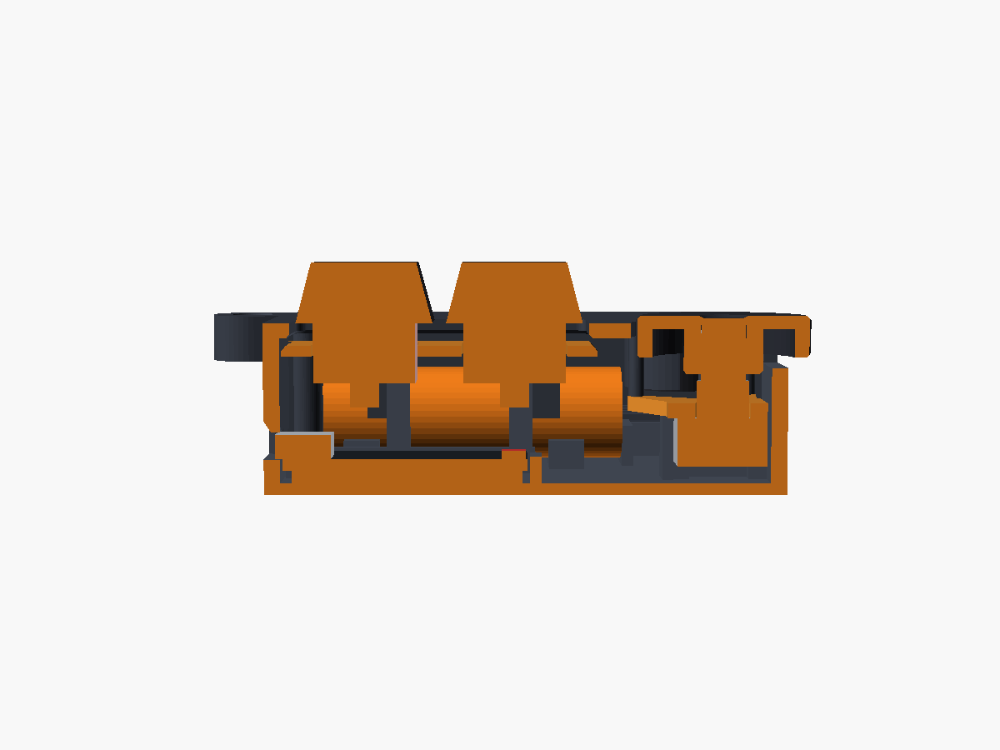
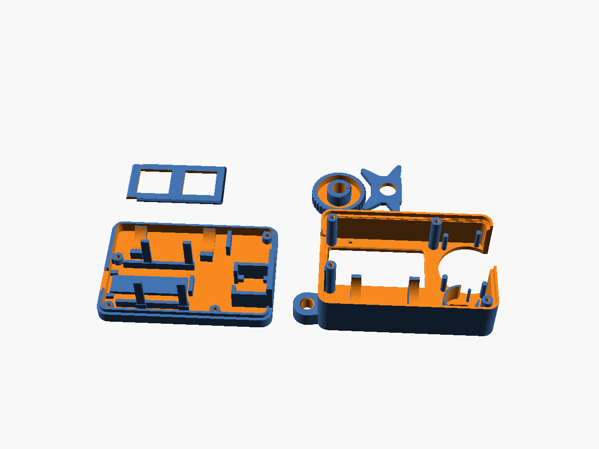

# nRF52840 BLE Camera Remote — Option A Pocket Clicker Enclosure

Parametric, **100% support-free** 3D-printable enclosure built in OpenSCAD (`nrf_remote_case.scad`) for the **Option A Pocket Clicker** layout: two Cherry MX mechanical keys on top inside a low-profile `3.0 mm` protective bezel, a custom knurled bare EC11 thumbwheel roller peeking `3.0 mm` out the right edge (`+X`), a rear-left integrated keychain loop, a `Ø12 mm` piezo buzzer under top acoustic slots, and a flush-bottom `M1.6` fastener interface.

| Assembled View | Exploded Stackup |
| :---: | :---: |
|  |  |

| Longitudinal Cutaway (`Y = 16.8 mm`) | Print Plate (`Z = 0`, 0% Supports) |
| :---: | :---: |
|  |  |

---

## 1. Dimensions & Hardware Fit

- **Main Enclosure Envelope:** `70.0 × 48.0 × 23.0 mm` (`79.9 mm` max length including keychain loop, `73.0 mm` including `3.0 mm` thumbwheel side peek, `24.0 mm` height to thumbwheel top face).
- **Direct-Wired Layout (No Perfboard, No External Reset Button):**
  - **MCU:** Pro Micro / SuperMini nRF52840 (`17.9 × 32.8 mm` PCB, `33.8 mm` w/ USB-C), seated on a central spine with `1.6 mm` underside solder/wire trenches, `5.0 mm` side-rail relief at the USB-C end for `B+`/`B-` pads, and the `C3` chip antenna kept clear of battery and screws.
  - **Battery:** Cylindrical `3.7 V` Li-Ion cell (`Ø13.2 × 42.6 mm`) inside a `Ø13.8 × 46.6 mm` saddle bay (`4.0 mm` wire-exit relief at the `-X` end).
  - **Triggers 1 & 2:** 2 × Cherry MX plate-mount mechanical switches (`14.15 × 14.15 mm` snap cutouts in a drop-in `1.50 mm` switch plate) with relegendable square keycaps, supported underneath by 4 rigid `bottom_tray` posts.
  - **Rotary Encoder:** Bare EC11 (`12.0 × 12.5 × 6.5 mm` body, M7 bushing, `Ø6.0 mm` shaft) in a `bottom_tray` U-cradle (`2.2 mm` underside pin/wire tunnel), locked vertically by `ec11_retainer_plate` + 4 `top_shell` hold-down columns, topped with a `Ø23.4 mm` knurled thumbwheel roller (roll on `+X` edge + click down on Z).
  - **Piezo Buzzer:** `Ø12.0 × 8.5 mm` passive buzzer inside an inverted `top_shell` C-clip with 3 crush ribs under 3 acoustic slots.
  - **Extras:** Integrated rear-left keychain loop (`Ø5.0 mm` bore, `3.2 mm` perimeter wall) + `Ø1.8 mm` subtle front-rim LED light-bleed pinhole.
- **Fasteners:** `4 × M1.6 × 5 mm` or `6 mm` **Thin Flat Wafer Head** screws (or `DIN 912` hex socket screws) into `Ø1.45 mm` blind pilots (`Ø3.80 × 1.80 mm` universal counterbores with `45°` support-free transition cones).

---

## 2. Exported STL Inventory

| File | Description | Triangles | Bounding Box (`X × Y × Z`) |
| :--- | :--- | ---: | :--- |
| [nrf_remote_top_shell.stl](stl/nrf_remote_top_shell.stl) | Top shell (printed face-down, key-well, buzzer clip, keychain lug) | `7,836` | `79.9 × 48.0 × 18.15 mm` |
| [nrf_remote_bottom_tray.stl](stl/nrf_remote_bottom_tray.stl) | Bottom tray (MCU & battery cradles, EC11 U-bay, dust sill, plate posts) | `3,468` | `70.0 × 48.0 × 18.45 mm` |
| [nrf_remote_mx_switch_plate.stl](stl/nrf_remote_mx_switch_plate.stl) | Drop-in `1.50 mm` Cherry MX switch snap plate | `766` | `42.2 × 21.8 × 1.5 mm` |
| [nrf_remote_ec11_retainer.stl](stl/nrf_remote_ec11_retainer.stl) | 4-arm bare EC11 clamp plate (`Ø7.40 mm` M7 hole) | `632` | `18.1 × 28.8 × 2.0 mm` |
| [nrf_remote_thumbwheel.stl](stl/nrf_remote_thumbwheel.stl) | 36-flute knurled thumbwheel roller (`Ø23.4 mm`, stress-relieved shaft hub) | `2,628` | `23.33 × 23.33 × 7.8 mm` |
| [nrf_remote_print_plate_all.stl](stl/nrf_remote_print_plate_all.stl) | All 5 parts arranged flat on bed (`Z = 0`) for single-job slicing | `15,340` | `158.0 × 89.1 × 18.45 mm` |
| [nrf_remote_calibration_coupon.stl](stl/nrf_remote_calibration_coupon.stl) | Quick tolerance swatch (MX snap, M1.6 pilot/counterbore, M7 hole, shaft bore) | `1,592` | `64.0 × 26.0 × 8.0 mm` |

---

## 3. Anycubic Kobra 3 v2 Print Settings

- **Supports:** **None (`0%`)** — all parts print flat at `Z = 0` with `<= 45°` bevels and short bridges.
- **Nozzle / Layer Height:** `0.40 mm` nozzle, `0.20 mm` layer height (`0.16 mm` optional for extra-crisp thumbwheel knurling).
- **Perimeters / Walls:** `3–4` wall loops (`1.2–1.6 mm` wall shell) so bosses, rabbet lip, and keychain lug print solid.
- **Infill:** `15–20%` Gyroid or Cubic.
- **Material:** PLA+ or PETG (Matte Charcoal / Black PLA+ recommended; avoid conductive carbon-fiber filaments near the `C3` BLE antenna).

---

## 4. Recommended Bench Workflow & Assembly Order

1. **Print Calibration Swatch First:** Slice and print [nrf_remote_calibration_coupon.stl](stl/nrf_remote_calibration_coupon.stl) (~15 min). Test-fit one Cherry MX switch snap (`14.15 mm`), `M1.6` pilot thread bite (`1.45 mm`), `M1.6` wafer/DIN 912 counterbore flushness (`3.80 mm`), EC11 M7 collar (`7.40 mm`), and thumbwheel shaft press-fit (`6.05 mm`). Adjust `FIT_TOL`, `MX_CUTOUT`, or `WHEEL_SHAFT_FIT` in [nrf_remote_case.scad](nrf_remote_case.scad) if needed and regenerate with `python hardware/case/build_case.py`.
2. **Print Full Enclosure:** Print [nrf_remote_print_plate_all.stl](stl/nrf_remote_print_plate_all.stl) (or individual STLs).
3. **Wire & Pre-Assemble Internals:**
   - Trim/bend the 5 bare EC11 pins slightly inward (`< 2.0 mm` drop below body), solder flexible silicone wires (`D2`, `D3`, `D7`, `GND`), seat the EC11 into `bottom_tray`'s U-cradle, and place `ec11_retainer` over the M7 collar.
   - Snap both Cherry MX switches into `mx_switch_plate` (orientation: pins aligned along Y or X cleanly away from center post) and solder wire pigtails (`D5`, `D4`, `GND`) keeping bends flat (`<= 1.5 mm` below pin tips).
   - Solder the `Ø12 mm` piezo buzzer leads (`D6`, `GND`) and press the buzzer into `top_shell`'s C-clip (leads exiting toward `-X / -Y`).
   - Route the battery (`B+`, `B-`) through the `5.0 mm` rail-relieved front gap onto the MCU, seat the cylindrical Li-Ion cell into the saddle bay, and seat the Pro Micro nRF52840 onto its central spine with USB-C facing `-X`.
4. **Close & Fasten:**
   - Seat `mx_switch_plate` into `top_shell`'s key-well pocket, drop `bottom_tray` into `top_shell` (aligning the USB-C arch and `+X` dust-shield sill), and tighten `4 × M1.6 × 5 mm` (or `6 mm`) wafer-head screws snugly into the bottom counterbores (do not over-torque into PLA).
   - Press the `thumbwheel` onto the EC11 knurled shaft through the top window and snap your two relegendable keycaps onto the MX stems.

---

## 5. Regenerating & Running CSG Collision Verification

```powershell
python hardware/case/build_case.py
```

The script automatically locates OpenSCAD (`C:\Users\arunj\openscad_portable\openscad-2021.01\openscad.com`), runs all compile-time `assert()` checks, exports all 7 binary STLs, runs 9 3D CSG `intersection()` collision checks across every printed part and hardware envelope, and renders all 6 PNG views in [renders/](renders).
